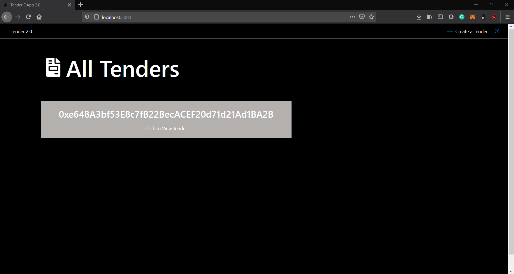
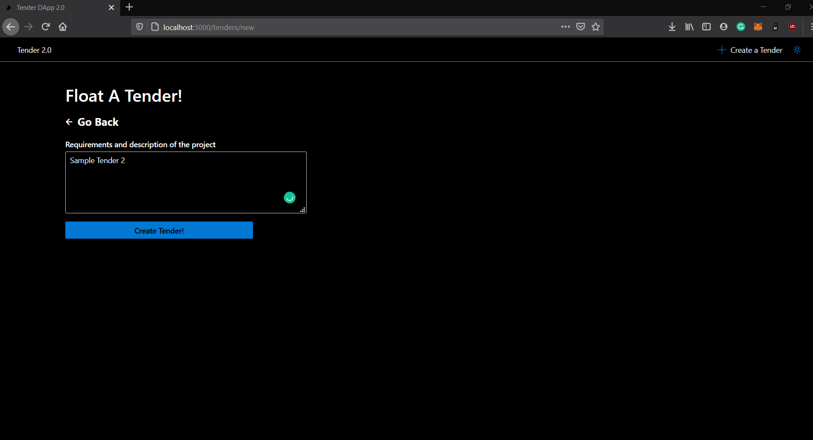
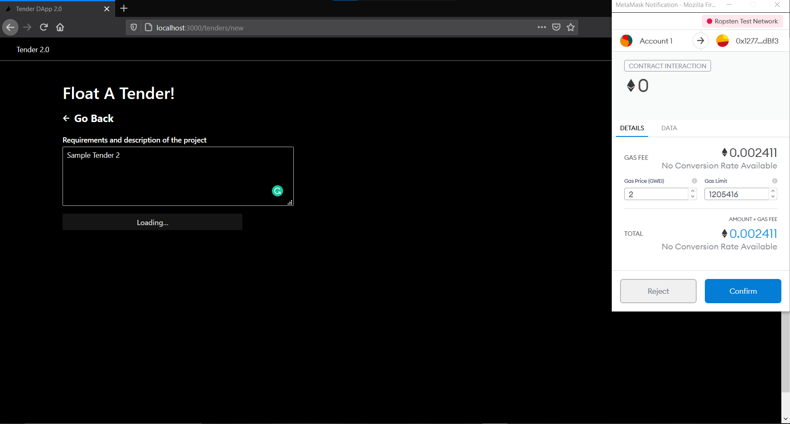
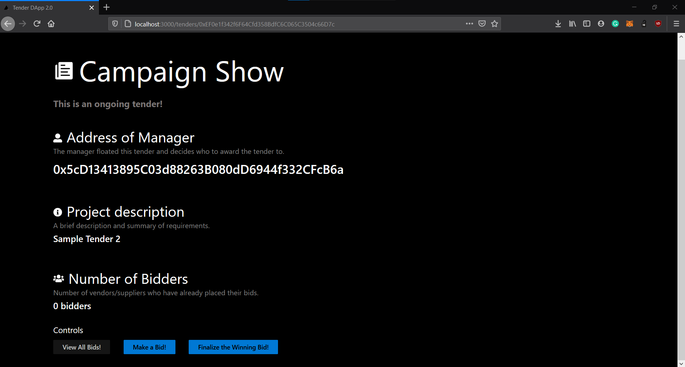
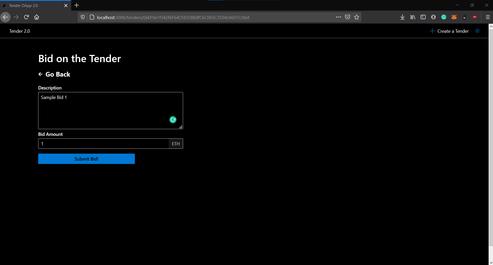
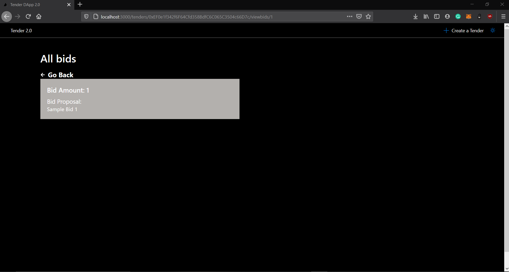
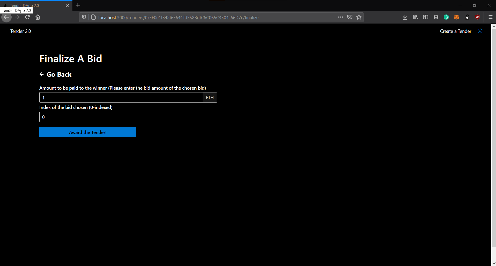
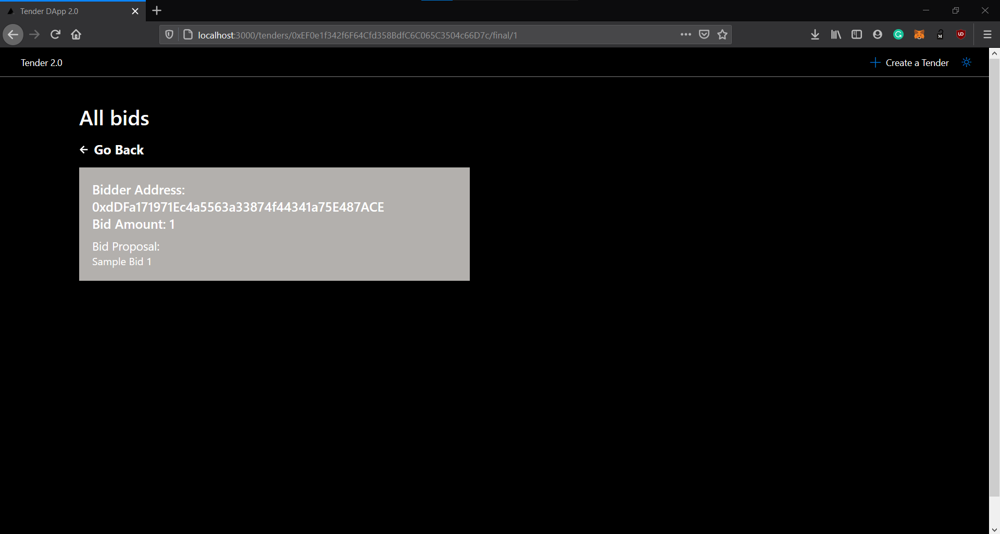
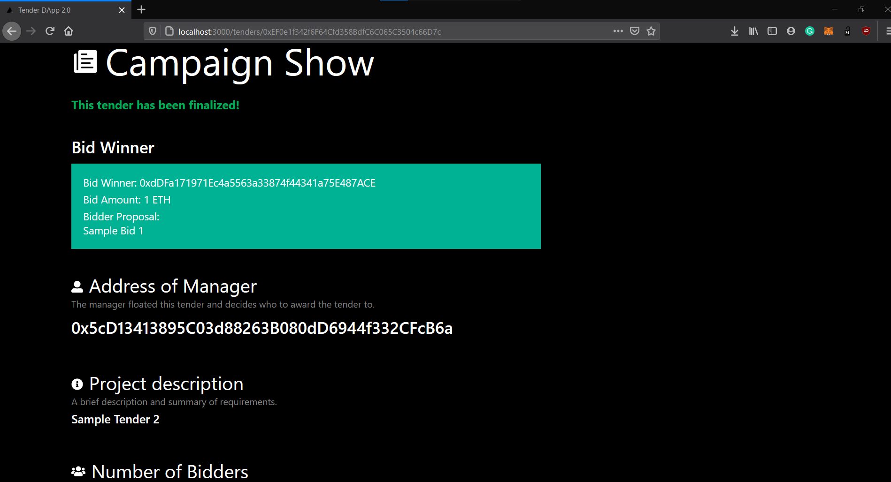

## What is Tender 2.0?
Tender 2.0 is a fair and transparent Blockchain-based tendering framework that aims to address various challenges being faced by the tendering system in-place currently.

## What are Tenders?
Tenders, also known as Public Procurement, is a core government function that allows various governmental organizations to provide essential products and services to citizens by outsourcing the said production/service to an external organization. The challenges faced by the current system in-place are:
1. The lack of trust and transparency among the stakeholders
2. Corruption and bias towards certain parties
3. Collusiom between the bidders

## How does Tender 2.0 solve these challenges?
1. Lack of trust and transparency among the stakeholders: We use the Ethereum blockchain network in order to maintain transparency among the stakeholders during the tendering process. In order to maintain transparency regarding government spending in the public, we use smart contracts, written in Solidity (a Turing-complete programming language) to reveal the bid details only after the tendering process is complete.

2. Corruption and bias: We use smart contracts in order to eliminate corruption and bias. When the tender is ongoing and has not been awarded yet, only relevant non-personal details like bid amount and bid proposal will be revealed to the manager/administrator, in order to keep the bidders' personal
details private and the process fair.

3. Collusion: The details of all the bids are not visible to anyone but the administrator or manager till the tender has been successfully awarded in order to prevent collusion.

## Steps to run
1. Install the MetaMask wallet extension on your browser (available for Firefox and Google Chrome) and create an account. Note down the 12-word seed phrase
and enter it in the ethereum/deploy.js file.

2. Create two accounts on the Ropsten network and get some ETH (not real ETH, since its a testnet) using  Ropsten ETH faucets (get atleast 2 accounts with ETH) - (https://faucet.ropsten.be/) and (https://faucet.dimensions.network/). 

3. Register an account on [Infura](https://infura.io/) and create a new project - get the Ropsten URL from the 'Settings' Page and copy it into the instantiation of Web3
in ethereum/web3.js and ethereum/deploy.js.

4. Run the compilation script in order to compile the smart contracts and output (node compile.js)
the JSON interface into the build directory (two files - tender and tenderFactory will be created)

5. Run the deployment script in order to deploy the smart contract to the Ethereum blockchain (node deploy.js)

6. After deploying the tenderFactory contract, update the contract address in the ethereum/factory.js (the new value is displayed on the terminal when deplyment script is run)

7. Run the server using 'npm start' command and go to http://localhost:3000 to use the application

## Screenshots of Working

Tender 2.0 Dashboard 

Floating a new Tender

 

Transaction Screen

Displaying Details of an ongoing Tender

Submit a Bid

View Bids when the Tender is Ongoing

Award the tender to the best bidder

View final bids when the tender has been awarded

Concluded Tender Dashboard

